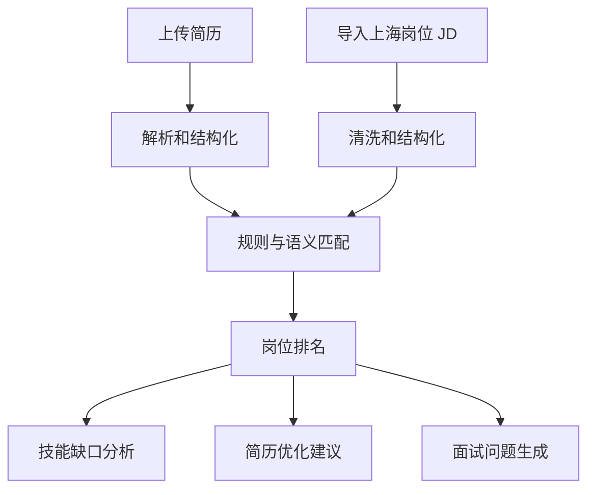

# AI秋招岗位匹配与简历优化 Agent — Project Handoff

> 文档用途：供开发者、协作者或编码 Agent 接手项目时直接使用  
> 项目阶段：需求与技术方案已确定，待开始实现  
> 目标用户：寻找上海地区数据挖掘、算法、大模型及 AI 应用岗位的应届生  
> 建议开发周期：7～10 天（个人开发）

---

## 1. 项目概述

### 1.1 项目名称

AI秋招岗位匹配与简历优化 Agent（AI Job Matching & Resume Optimization Agent）

### 1.2 项目目标

构建一个面向秋招求职者的 AI 应用。用户上传个人简历并导入招聘岗位 JD 后，系统能够：

1. 从简历中提取教育、技能、项目、科研、证书等结构化信息；
2. 从招聘 JD 中提取岗位职责、硬性要求、加分项和工作地点；
3. 基于规则匹配、向量相似度和大模型判断计算岗位匹配度；
4. 按匹配程度推荐上海地区数据挖掘和 AI 相关岗位；
5. 识别用户相对岗位要求缺少的技能或经历；
6. 给出基于真实经历的简历修改建议，不生成虚假经历；
7. 根据简历和 JD 生成针对性的面试问题及回答要点；
8. 使用 Recall@K、MRR、nDCG@K、信息提取 F1 等指标评估系统。

### 1.3 项目定位

本项目应达到“可演示、可评测、可部署、可写入秋招简历”的水平，而不是单纯把简历和 JD 拼接后发送给大模型。

最低交付成果：

- 一个可以运行的 Web Demo；
- 一套清晰的匹配评分方法；
- 一份不少于 30 组样本的评测集；
- 一组可复现的实验结果；
- 完整 README、架构说明和演示材料。

---

## 2. 项目边界

### 2.1 MVP 范围

- 支持 PDF、DOCX、TXT、Markdown 简历；
- 支持粘贴单条 JD 或批量导入 CSV/JSON 岗位；
- 默认只推荐工作地点为上海的岗位；
- 支持大模型、AI应用、机器学习、数据挖掘、搜索推荐、数据科学岗位；
- 输出岗位排名、匹配分数、命中技能、缺失技能、简历建议和面试问题；
- 使用 Streamlit 完成交互界面；
- 使用 SQLite 保存岗位和分析记录；
- 使用 FAISS 保存岗位向量索引。

### 2.2 暂不实现

- 自动登录招聘网站；
- 自动投递简历；
- 绕过验证码或招聘网站访问限制；
- 自动修改用户原始简历文件；
- 大规模爬取受限制网站；
- 自行预训练大语言模型；
- 企业级权限、计费和高并发系统。

---

## 3. 核心用户流程



典型操作步骤：

1. 用户上传简历；
2. 系统展示解析结果，允许用户检查和修正；
3. 用户导入岗位数据或从系统岗位库中选择；
4. 系统过滤 `location=上海` 的岗位；
5. 系统计算匹配分数并返回 Top-K 岗位；
6. 用户打开某个岗位查看评分解释；
7. 系统给出技能缺口、修改建议和模拟面试题；
8. 用户可导出 Markdown 分析报告。

---

## 4. 推荐技术栈

| 模块 | 推荐方案 | 备选方案 |
|---|---|---|
| 开发语言 | Python 3.11 | Python 3.10+ |
| Web UI | Streamlit | Gradio、FastAPI + React |
| API 服务 | FastAPI | Flask |
| 大模型 | DeepSeek/OpenAI 兼容 API | 本地 Qwen、其他兼容 API |
| Embedding | BGE-M3 | bge-large-zh-v1.5、text-embedding 模型 |
| 向量索引 | FAISS | Chroma、Milvus |
| 数据库 | SQLite | PostgreSQL |
| 数据校验 | Pydantic v2 | dataclasses |
| PDF 解析 | PyMuPDF | pdfplumber |
| DOCX 解析 | python-docx | mammoth |
| 数据分析 | pandas、NumPy | Polars |
| 评测 | scikit-learn | 自定义脚本 |
| 测试 | pytest | unittest |
| 部署 | Docker | 本地虚拟环境 |

实现原则：优先直接调用模型 API，只有在确实需要多阶段编排时再引入 LangChain，避免框架过重。

---

## 5. 系统架构

### 5.1 分层设计

| 层级 | 主要职责 |
|---|---|
| UI 层 | 文件上传、岗位筛选、结果展示、报告导出 |
| API/Service 层 | 编排简历解析、JD 解析、匹配、建议生成 |
| Domain 层 | 数据模型、评分规则、技能标准化、过滤逻辑 |
| AI 层 | LLM 信息提取、Embedding、缺口解释、面试题生成 |
| Data 层 | SQLite、FAISS、岗位原始文件、评测集 |

### 5.2 推荐目录结构

```text
ai-job-agent/
├── app.py
├── README.md
├── pyproject.toml
├── .env.example
├── Dockerfile
├── docker-compose.yml
├── configs/
│   ├── settings.yaml
│   ├── skill_aliases.yaml
│   └── scoring.yaml
├── data/
│   ├── raw_jobs/
│   ├── processed_jobs/
│   ├── evaluation/
│   └── faiss_index/
├── src/
│   ├── api/
│   ├── parsers/
│   │   ├── resume_parser.py
│   │   └── job_parser.py
│   ├── extractors/
│   │   ├── resume_extractor.py
│   │   └── job_extractor.py
│   ├── matching/
│   │   ├── rule_matcher.py
│   │   ├── semantic_matcher.py
│   │   ├── score_fusion.py
│   │   └── ranker.py
│   ├── retrieval/
│   │   ├── embeddings.py
│   │   └── faiss_store.py
│   ├── agents/
│   │   ├── resume_advisor.py
│   │   └── interview_agent.py
│   ├── evaluation/
│   │   ├── extraction_metrics.py
│   │   └── ranking_metrics.py
│   ├── models/
│   │   └── schemas.py
│   ├── repositories/
│   │   ├── job_repository.py
│   │   └── analysis_repository.py
│   └── utils/
├── tests/
│   ├── unit/
│   ├── integration/
│   └── fixtures/
├── scripts/
│   ├── import_jobs.py
│   ├── build_index.py
│   └── run_evaluation.py
└── docs/
    ├── architecture.md
    ├── evaluation.md
    └── demo_script.md
```

---

## 6. 数据结构

### 6.1 简历结构 `ResumeProfile`

```json
{
  "candidate_id": "candidate_001",
  "education": [
    {
      "school": "",
      "degree": "硕士",
      "major": "",
      "start_date": "",
      "end_date": ""
    }
  ],
  "skills": ["Python", "PyTorch", "RAG", "FAISS"],
  "projects": [
    {
      "name": "",
      "description": "",
      "technologies": [],
      "responsibilities": [],
      "metrics": []
    }
  ],
  "research": [],
  "internships": [],
  "certificates": ["JLPT N2"],
  "preferred_locations": ["上海"],
  "preferred_roles": ["AI应用", "数据挖掘", "大模型算法"]
}
```

### 6.2 岗位结构 `JobProfile`

```json
{
  "job_id": "job_001",
  "company": "",
  "title": "",
  "location": "上海",
  "employment_type": "校园招聘",
  "graduation_window": "2026-09至2027-08",
  "responsibilities": [],
  "required_skills": [],
  "preferred_skills": [],
  "education_requirement": "本科及以上",
  "major_requirements": [],
  "keywords": [],
  "source_url": "",
  "published_at": "",
  "deadline": "",
  "raw_text": ""
}
```

### 6.3 匹配结果 `MatchResult`

```json
{
  "candidate_id": "candidate_001",
  "job_id": "job_001",
  "total_score": 82.5,
  "subscores": {
    "required_skill": 88.0,
    "preferred_skill": 70.0,
    "project": 85.0,
    "semantic": 84.0,
    "education": 100.0,
    "location": 100.0
  },
  "matched_skills": [],
  "missing_required_skills": [],
  "missing_preferred_skills": [],
  "evidence": [],
  "recommendation": "优先投递"
}
```

---

## 7. 核心模块设计

### 7.1 文件解析模块

输入：PDF、DOCX、TXT、MD 文件。  
输出：纯文本、段落列表、基础元数据。

要求：

- 去除页眉、页脚和重复换行；
- 保留项目名称、时间和列表层级；
- 扫描版 PDF 在 MVP 阶段提示用户改用可复制版本；
- 文件解析失败时提供明确错误信息。

### 7.2 结构化信息提取模块

采用“大模型结构化输出 + Pydantic 校验”方式。

要求：

- 模型必须只提取原文存在的信息；
- 不确定字段返回空值，不允许猜测；
- JSON 校验失败时最多自动重试两次；
- 保存原始文本到结构化字段的证据片段；
- 对技能名称执行标准化。

技能标准化示例：

```yaml
PyTorch:
  - pytorch
  - torch
大语言模型:
  - LLM
  - 大模型
检索增强生成:
  - RAG
  - retrieval augmented generation
```

### 7.3 岗位过滤模块

默认硬过滤规则：

1. `location` 必须包含“上海”；
2. 岗位必须为校招、应届生或明确接受 2027 届；
3. 岗位类别必须属于 AI、算法、数据挖掘、数据科学、搜索推荐或相关方向；
4. 已明确截止的岗位默认隐藏，但可通过开关查看。

### 7.4 向量检索模块

推荐使用 BGE-M3 为简历项目描述和岗位职责生成向量。

索引字段：

- 岗位标题；
- 岗位职责；
- 必需技能；
- 加分技能；
- 合并后的岗位检索文本。

推荐流程：

1. 使用用户技能与项目经历构建查询文本；
2. 从上海岗位库召回 Top-20；
3. 对 Top-20 执行精细评分；
4. 返回 Top-5 或 Top-10。

### 7.5 匹配评分模块

初始评分公式：

\[
Score = 0.30S_{required}+0.10S_{preferred}+0.20S_{project}
+0.20S_{semantic}+0.10S_{education}+0.10S_{location}
\]

说明：

- `required`：硬性技能覆盖率；
- `preferred`：加分技能覆盖率；
- `project`：候选人项目与岗位职责的匹配程度；
- `semantic`：简历与 JD 的语义相似度；
- `education`：学历和专业是否满足；
- `location`：是否满足上海偏好。

评分规则：

- 缺少明确硬性学历要求时，应设置上限或扣分；
- 缺少一项普通技能不直接判定不合格；
- 地点不是上海时直接过滤，而不是仅扣分；
- 总分必须附带可解释的分项和证据；
- 大模型只能用于辅助判断项目匹配度，不能独立决定最终总分。

推荐等级：

| 总分 | 等级 | 处理建议 |
|---|---|---|
| 85～100 | 高度匹配 | 优先投递并定制简历 |
| 70～84 | 较为匹配 | 建议投递，补强少量技能 |
| 55～69 | 一般匹配 | 可作为扩展选择 |
| 0～54 | 匹配较低 | 暂不优先 |

### 7.6 简历优化模块

输出内容：

- 当前简历与岗位匹配的亮点；
- 缺少的硬性技能；
- 可以补充但必须真实存在的内容；
- 项目描述重写建议；
- 推荐增加的量化指标；
- 推荐删除的无关信息。

强制约束：

- 不得编造实习、论文、比赛、指标或技术；
- 对缺失经历只能给出“学习/项目补充建议”；
- 重写内容必须能够追溯到原简历证据；
- 输出中区分“可直接修改”和“完成相关工作后才能加入”。

### 7.7 面试问题生成模块

问题分类：

- 简历项目深挖；
- 岗位知识匹配；
- 编程和算法基础；
- 机器学习/数据挖掘；
- RAG与大模型应用；
- 系统设计；
- 项目问题与故障排查；
- 行为面试。

每个问题应包含：

- 问题；
- 考察点；
- 回答结构；
- 可能追问；
- 与简历或 JD 的关联证据。

---

## 8. 岗位数据来源与导入

MVP 不要求自动爬取。优先采用手动或半自动导入，避免数据合规问题。

建议数据来源：

- 企业校园招聘官网；
- 企业官方招聘公众号中公开的 JD；
- 用户自行粘贴的岗位信息；
- 用户维护的 CSV/JSON 岗位表。

CSV 最低字段：

```csv
job_id,company,title,location,description,source_url,published_at,deadline
```

数据更新规则：

- 相同公司、岗位标题和来源 URL 视为同一岗位；
- 更新时保留最后检查时间；
- 截止日期早于当前日期时标记 `expired=true`；
- 无法确认状态的岗位标记 `status=unknown`，不得显示为“正在招聘”。

---

## 9. API 草案

### 9.1 解析简历

```http
POST /api/resumes/parse
Content-Type: multipart/form-data
```

响应：`ResumeProfile`

### 9.2 导入岗位

```http
POST /api/jobs/import
Content-Type: application/json
```

响应：导入数量、失败数量和错误列表。

### 9.3 获取岗位推荐

```http
POST /api/matches/rank
Content-Type: application/json
```

请求示例：

```json
{
  "candidate_id": "candidate_001",
  "location": "上海",
  "top_k": 10,
  "include_expired": false
}
```

响应：`MatchResult[]`

### 9.4 生成简历建议

```http
POST /api/advice/resume
```

### 9.5 生成面试问题

```http
POST /api/interview/questions
```

---

## 10. 评测方案

### 10.1 评测集

第一版准备：

- 3～5份匿名或合成简历；
- 30～50条上海 AI/数据岗位 JD；
- 每份简历对应人工标注的高、中、低匹配岗位；
- 关键字段人工标注结果；
- 技能标准化映射表。

合成简历必须标明为测试数据，不得冒充真实候选人经历。

### 10.2 指标

结构化信息提取：

- Precision；
- Recall；
- F1；
- JSON Schema 成功率。

岗位召回与排序：

- Recall@5；
- Recall@10；
- MRR；
- nDCG@5；
- nDCG@10。

工程指标：

- 单份简历解析时间；
- 单次 Top-10 推荐耗时；
- 单次分析 API Token 与费用；
- 失败率；
- 缓存命中率。

### 10.3 基线与消融实验

至少比较以下方法：

1. 仅关键词匹配；
2. 仅 Embedding 相似度；
3. 关键词 + Embedding；
4. 关键词 + Embedding + 规则融合；
5. 完整方法：规则融合 + LLM项目相关性判断。

实验目的是证明各模块是否真正提升推荐效果，而不是只展示最终数字。

### 10.4 建议验收阈值

| 指标 | MVP目标 |
|---|---:|
| JSON结构化输出成功率 | ≥95% |
| 技能提取F1 | ≥0.85 |
| Recall@5 | ≥0.75 |
| nDCG@5 | ≥0.70 |
| 单份简历完整分析时间 | ≤30秒 |
| 未捕获异常导致的任务失败率 | ≤5% |

阈值可根据评测集难度调整，但必须记录数据规模和实验设置。

---

## 11. UI 页面设计

### 页面一：简历解析

- 文件上传；
- 简历文本预览；
- 结构化字段展示；
- 用户修改和确认按钮。

### 页面二：岗位库

- 公司、岗位、工作地点、发布日期和截止日期；
- 默认筛选上海；
- 支持大模型、数据挖掘、推荐、数据科学等标签；
- 支持导入 CSV/JSON 和粘贴 JD。

### 页面三：岗位推荐

- Top-K 排名；
- 总分和分项分数；
- 已匹配技能；
- 缺失技能；
- 评分解释；
- 原始投递链接。

### 页面四：简历优化

- 针对选中岗位生成建议；
- 原描述与建议描述对照；
- 显示修改依据；
- 标记禁止直接写入的待补充经历。

### 页面五：模拟面试

- 选择岗位和问题难度；
- 展示问题、考察点和回答框架；
- 记录用户回答并给出反馈，作为可选增强功能。

---

## 12. 安全、隐私与合规

- 简历属于个人敏感信息，日志中不得记录完整简历文本；
- API Key 只允许通过环境变量读取；
- `.env` 必须加入 `.gitignore`；
- 默认本地保存，可提供一键删除个人分析记录；
- 发给外部模型前提示用户数据处理方式；
- 对姓名、手机号、邮箱等字段提供脱敏选项；
- 不自动投递岗位，不执行任何招聘网站账户操作；
- 不允许模型编造候选人经历。

---

## 13. 配置项

`.env.example` 建议包含：

```env
LLM_API_KEY=
LLM_BASE_URL=
LLM_MODEL=
EMBEDDING_MODEL=BAAI/bge-m3
DATABASE_URL=sqlite:///data/app.db
DEFAULT_LOCATION=上海
TOP_K=10
```

`scoring.yaml` 建议包含：

```yaml
weights:
  required_skill: 0.30
  preferred_skill: 0.10
  project: 0.20
  semantic: 0.20
  education: 0.10
  location: 0.10
thresholds:
  high: 85
  medium: 70
  low: 55
```

---

## 14. 开发计划

### 第1阶段：工程骨架与解析（第1～2天）

- 初始化项目、依赖和配置；
- 实现 PDF/DOCX/TXT/MD 解析；
- 定义 Pydantic 数据模型；
- 完成简历和 JD 结构化提取；
- 编写基础单元测试。

完成标准：可将一份简历和一条 JD 稳定转换为合法 JSON。

### 第2阶段：岗位库与检索（第3～4天）

- 创建 SQLite 表；
- 实现岗位导入、去重、过滤；
- 接入 BGE-M3；
- 建立 FAISS 索引；
- 实现上海岗位 Top-20 召回。

完成标准：可以从岗位库中检索出语义相关的上海岗位。

### 第3阶段：评分与解释（第5天）

- 实现技能匹配；
- 实现项目与 JD 匹配；
- 实现加权评分和等级；
- 输出匹配证据和技能缺口。

完成标准：同一输入重复运行时，规则分数稳定且解释一致。

### 第4阶段：Agent能力与UI（第6～7天）

- 实现简历优化建议；
- 实现面试问题生成；
- 完成 Streamlit 页面；
- 支持 Markdown 报告导出。

完成标准：用户可以完成从上传简历到导出结果的完整流程。

### 第5阶段：评测与交付（第8～10天）

- 构建评测集；
- 实现 Recall、MRR、nDCG 和 F1；
- 运行基线和消融实验；
- 修复问题并补充测试；
- 编写 README、演示脚本和简历描述；
- 使用 Docker 验证全新环境启动。

完成标准：代码、Demo、指标、文档和演示材料齐全。

---

## 15. 验收清单

### 功能验收

- [ ] 能解析至少四种简历文件格式；
- [ ] 能提取简历和 JD 的结构化信息；
- [ ] 能导入并过滤上海岗位；
- [ ] 能返回 Top-K 岗位推荐；
- [ ] 每个推荐结果具有分项评分和证据；
- [ ] 能生成真实、可追溯的简历建议；
- [ ] 能生成岗位相关面试问题；
- [ ] 能导出 Markdown 分析报告。

### 工程验收

- [ ] 配置和 API Key 未硬编码；
- [ ] 有单元测试和至少一条端到端测试；
- [ ] 失败情况有明确提示；
- [ ] README 可以指导新用户启动项目；
- [ ] Docker 镜像能够成功构建；
- [ ] 不在日志中输出完整个人简历。

### 算法验收

- [ ] 有人工标注的评测集；
- [ ] 实现 Recall@K、MRR、nDCG@K；
- [ ] 实现信息提取 Precision、Recall、F1；
- [ ] 完成至少三组基线或消融实验；
- [ ] 实验记录包含模型、参数、数据量和运行时间。

---

## 16. 主要风险与处理方式

| 风险 | 影响 | 处理方式 |
|---|---|---|
| LLM生成不合法JSON | 解析失败 | JSON Schema约束、Pydantic校验、有限重试 |
| 模型编造简历经历 | 求职诚信风险 | 强制引用原文证据，缺失信息返回空值 |
| 技能同义词导致漏匹配 | 召回率降低 | 维护技能别名表，并结合Embedding |
| 仅按相似度导致岗位排序不合理 | 推荐质量下降 | 加入硬性要求、学历和技能规则 |
| 岗位状态过期 | 推荐无效 | 保存截止日期和最后检查时间 |
| API成本或延迟过高 | 体验差 | 缓存结构化结果，只对Top-N精排 |
| 简历泄露 | 隐私风险 | 本地存储、脱敏、日志过滤和删除功能 |
| 项目范围过大 | 无法按期完成 | 先完成MVP，爬虫和自动投递不纳入首版 |

---

## 17. README必须包含的内容

1. 项目简介；
2. 功能截图或GIF；
3. 系统架构；
4. 技术栈；
5. 安装和启动方法；
6. 配置文件说明；
7. 岗位数据格式；
8. 匹配评分方法；
9. 评测集和指标；
10. 实验结果；
11. 隐私说明；
12. 已知限制；
13. 后续计划。

---

## 18. 演示脚本

建议控制在 3～5 分钟：

1. 介绍痛点：秋招岗位多、JD要求不统一、简历难以针对性修改；
2. 上传一份脱敏简历；
3. 展示结构化解析结果；
4. 导入或选择上海 AI 岗位库；
5. 展示 Top-5 推荐岗位和评分解释；
6. 打开一个大模型岗位，展示技能缺口；
7. 生成简历修改建议；
8. 生成岗位定制面试题；
9. 展示 Recall@5、nDCG@5 和消融实验结果；
10. 简要介绍隐私保护和后续功能。

---

## 19. 可用于简历的项目描述

### 简洁版

**AI秋招岗位匹配与简历优化 Agent**  
基于大语言模型、BGE-M3与FAISS构建面向上海AI岗位的智能匹配系统，实现简历/JD结构化解析、混合召回、多维度匹配评分、技能缺口分析及面试问题生成；构建人工标注评测集，使用Recall@K、MRR和nDCG评估推荐效果，并通过Streamlit与Docker完成应用部署。

### 面试展开要点

- 为什么不能只使用大模型直接评分；
- 如何设计结构化信息提取和失败重试；
- 为什么选择关键词、规则和Embedding融合；
- FAISS索引的数据组织方式；
- 匹配权重如何确定和调整；
- 如何构建人工标注评测集；
- Recall、MRR、nDCG分别反映什么；
- 如何防止大模型编造简历经历；
- 如何降低API成本和响应时间；
- 项目从Demo扩展到生产系统还需要什么。

---

## 20. 后续增强方向

按照优先级排序：

1. 根据用户反馈学习个性化匹配权重；
2. 增加岗位变化和截止日期提醒；
3. 引入Cross-Encoder对召回结果重排；
4. 增加简历版本管理与岗位定制版本对比；
5. 增加模拟面试对话和回答评分；
6. 支持项目经历知识图谱；
7. 引入离线本地模型保护隐私；
8. 使用PostgreSQL和Milvus扩展岗位规模；
9. 增加API监控、Tracing和系统评测；
10. 增加人工反馈闭环和在线实验。

---

## 21. 接手者的第一批任务

接手后按以下顺序执行：

1. 创建项目目录和Python虚拟环境；
2. 建立`pyproject.toml`和`.env.example`；
3. 实现`ResumeProfile`、`JobProfile`和`MatchResult`；
4. 完成PDF/DOCX文本解析；
5. 编写简历与JD结构化提取Prompt；
6. 加入Pydantic校验和重试；
7. 准备5条上海AI岗位测试数据；
8. 实现地点过滤和关键词基线；
9. 编写首批单元测试；
10. 提交第一个可运行版本。

首个里程碑定义：输入一份简历和5条岗位JD，系统能够正确过滤上海岗位，并输出结构化匹配结果。此阶段不要求界面精美。

---

## 22. 交接结论

项目需求、MVP边界、数据结构、评分方法、目录结构、评测方案和验收标准已经明确。开发时应优先确保：

1. 信息提取准确且不编造；
2. 匹配结果可解释；
3. 上海岗位过滤可靠；
4. 推荐效果能够被量化评估；
5. 完整流程可运行、可演示、可复现。

不要在首版投入大量时间开发自动爬虫、复杂前端或自动投递功能。先完成可靠的解析、召回、排序、评测和结果解释，才能形成有说服力的AI秋招项目。
