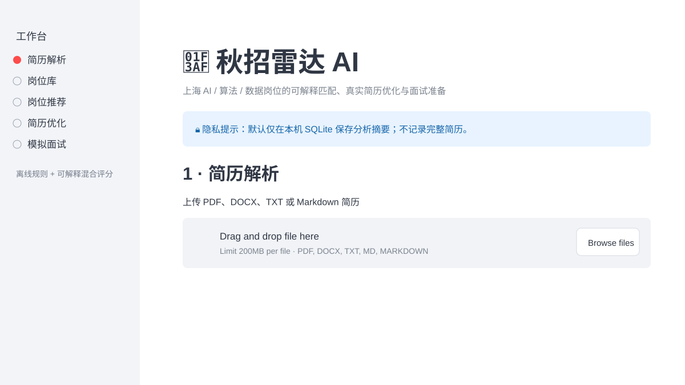

# 秋招雷达 AI：岗位匹配与简历优化 Agent

[](https://github.com/moquanCC/ai-job-agent/actions/workflows/ci.yml)

面向上海地区 AI、算法、数据挖掘、推荐与数据科学岗位的可解释求职助手。上传简历并导入岗位后，应用会完成结构化解析、上海校招硬过滤、混合评分、技能缺口分析、真实经历约束下的简历建议、岗位定制面试题与 Markdown 报告导出。

> 当前版本默认完全离线运行，不需要 API Key。它使用规则与字符 n-gram 向量作为可复现基线；配置文件预留了兼容模型参数，但本版本不会把简历发送到外部服务。



## 功能

- 解析 PDF、DOCX、TXT、Markdown 简历；扫描 PDF 会给出明确提示。
- 导入 CSV/JSON 岗位或粘贴单条 JD，SQLite 自动去重。
- 默认硬过滤上海、校招/应届、AI/算法/数据方向及未截止岗位。
- 按必需技能、加分技能、项目、语义、学历、地点六项评分并给出证据。
- 把建议分成“可直接修改”和“完成相关工作后才能加入”，防止编造经历。
- 生成项目深挖、岗位知识、技能缺口、系统设计和行为面试题。
- 导出完整 Markdown 分析报告，并支持删除个人分析记录。
- 内置 30 条企业官方公开 JD 快照，其中 27 条核验为在招；保留合成数据用于可复现的管线测试。
- 提供真实 JD 实验看板，展示排序方法对比、双模型标注一致性、分歧规模和实验局限。

## 快速开始

要求 Python 3.10+（开发验证环境为 Python 3.13）。

```powershell
python -m venv .venv
.venv\Scripts\Activate.ps1
pip install -e ".[dev]"
streamlit run app.py
```

浏览器打开 `http://localhost:8501`，进入“岗位库”并点击“一键加载 30 条官方 JD”。状态看板应显示 30 条岗位，其中在招 27 条、过期 2 条、待确认 1 条；表格中的链接可回溯至官方职位页。随后上传合成文件 `data/evaluation/demo_resume.md`，依次体验 Top-5 推荐、证据约束下的简历优化、岗位面试题与实验看板。演示无需导入合成岗位。

### UI 真实演示流程

1. 在“岗位库”一键加载仓库内已核验的 30 条官方 JD，并检查 `30 / 27 / 2 / 1` 状态统计与官方来源链接。
2. 在“简历解析”上传 `data/evaluation/demo_resume.md`；该候选人资料是合成数据，可安全用于公开演示。
3. 在“岗位推荐”运行 Top-5，查看状态、核验日期、官方来源、六项评分、技能命中与证据。
4. 选中一个岗位，在“简历优化”查看 grounded 建议，在“模拟面试”查看岗位定制题及关联依据。
5. 在“实验看板”比较关键词与规则融合方法，并审计标注一致性、分歧和三项实验限制。

演示的数据口径是：**真实官方公开 JD + 3 个合成候选人画像 + 双模型独立盲标与裁决形成的模型辅助评测基准**。`human_gold=false`，因此这些标签不能表述为真人专家标注或人类金标准。

## Docker 启动

```bash
docker compose up --build
```

打开 `http://localhost:8501`。容器将 `./data` 挂载到本地，分析数据不会随容器重建丢失。

## 项目结构

```text
app.py                         Streamlit 六页工作台
configs/                       技能别名、权重和运行配置
src/parsers/                   四类文件解析与结构化提取
src/matching/                  过滤、规则、语义、融合、排序
src/retrieval/                 离线向量与可持久化索引
src/repositories/              SQLite 岗位和分析记录
src/agents/                    简历建议、面试题、报告
src/evaluation/                F1、Recall、MRR、nDCG
scripts/                       样本、导入、索引和实验脚本
data/evaluation/               明确标注为合成的评测数据与结果
data/real_jobs/                官方公开 JD 与规则辅助相关性初标
tests/                         单元测试与完整流程测试
docs/                          架构、评测和演示材料
```

详细设计见 [系统架构](docs/architecture.md)，合成评测解释见 [评测说明](docs/evaluation.md)，真实 JD 实验口径见 [真实 JD 评测说明](docs/evaluation_real.md)。

## 岗位数据格式

CSV 最低字段：

```csv
job_id,company,title,location,description,source_url,published_at,deadline
```

JSON 是相同字段对象组成的数组。推荐额外提供 `employment_type`、`required_skills`、`preferred_skills`、`education_requirement`、`responsibilities` 和 `status`。无法确认的状态应使用 `unknown`，不要标为正在招聘。

真实数据位于 `data/real_jobs/jobs.json`：30 条均来自企业官方职位详情，覆盖百度、上海人工智能实验室和哔哩哔哩，包含来源证据和 2026-08-12 核验日期。90 个候选人—岗位对已完成独立双模型复标、一致性评估和逐条裁决；它是可复现实验基准，但不是两位真人专家形成的人类金标准。完整口径见 `docs/evaluation_real.md`。

研究文档更新后可重新生成并校验结构化数据：

```powershell
python scripts/compile_real_jobs.py
```

## 匹配评分

```text
Score = 0.30 × 必需技能 + 0.10 × 加分技能 + 0.20 × 项目
      + 0.20 × 语义相似 + 0.10 × 学历 + 0.10 × 地点
```

地点不是上海的岗位会在评分前过滤。每个结果均返回 0～100 分的六个分项、命中/缺失技能、简历证据和建议等级。权重可在 `configs/scoring.yaml` 调整。

## 配置

复制 `.env.example` 为 `.env` 或设置同名环境变量。当前离线版实际使用 `DATABASE_URL`、`DEFAULT_LOCATION` 和 `TOP_K`；`LLM_*` 是后续接入 OpenAI 兼容接口的保留项，不会被当前代码调用。

## 测试与评测

```powershell
pytest -q
python scripts/run_evaluation.py
python scripts/run_real_evaluation.py
python scripts/build_index.py --db data/app.db --output data/faiss_index
```

GitHub Actions 会在每次推送和 Pull Request 时使用 Python 3.11 执行源码编译、测试、合成数据再生成、双模型一致性与裁决复现、真实 JD 评测和 SQLite 导入冒烟测试，并保留 14 天的评测结果 artifact。

最新仓库内结果由 `data/evaluation/results.json` 给出。合成集用于验证管线和指标实现，不应用于宣称真实招聘效果；真实验收应替换为脱敏简历、真实公开 JD 和人工多标注者相关性标签。

“实验看板”读取 `data/real_jobs/evaluation_results.json` 与一致性报告，展示 30 条官方 JD（27 条在招）、3 个合成候选人画像、排序指标和双模型标注分歧。当前标签是双模型独立盲标后逐条裁决形成的模型辅助基准，`human_gold=false`；它适合黑客松中的可复现实验与流程审计，但不等同于真人专家评测，也不能用于宣称真实招聘效果。

## 隐私与安全

- 完整简历只保存在当前 Streamlit 会话，不写入日志或 SQLite。
- SQLite 仅保存岗位以及匹配/建议摘要，可在侧栏按候选人编号删除。
- API Key 仅允许通过环境变量读取，`.env` 已加入 `.gitignore`。
- 应用不登录招聘网站、不爬取受限内容、不自动投递。
- 缺少经历时只输出学习/项目补充建议，不生成虚假实习、论文、指标或技术。

## 已知限制

- 默认提取器是确定性规则，复杂版式、表格简历和模糊标题可能需要人工修正。
- 扫描 PDF 未集成 OCR；请改用可复制 PDF 或 DOCX。
- 离线字符向量不是 BGE-M3，语义泛化能力有限；生产化时应替换 Embedding 后重建索引。
- 当前真实 JD 实验仍使用 3 个合成候选人画像，相关性标签来自双模型裁决而非真人专家；正式招聘效果仍需脱敏真实简历和多人独立人工复标验证。
- 当前为单机 Demo，没有账户、权限、多租户和高并发能力。

## 后续计划

1. 接入带 JSON Schema 的 OpenAI 兼容提取器，并保留证据与最多两次重试。
2. 使用 BGE-M3 + FAISS 召回和 Cross-Encoder 精排。
3. 将当前 30 条官方 JD 扩展至 50 条和更多公司，并完成双人独立复标。
4. 增加简历版本对比、回答反馈和岗位截止提醒。

## 演示与项目表达

3～5 分钟演示路径见 [演示脚本](docs/demo_script.md)。项目可用于简历的表述与面试展开点也包含在该文档中。
