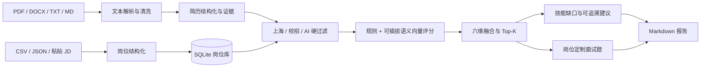

# 系统架构

## 数据流

## 边界与职责

| 模块 | 输入 | 输出 | 关键保证 |
|---|---|---|---|
| `parsers` | 文件字节、JD 字典 | `ResumeProfile`、`JobProfile` | 明确失败、原文证据、不猜测 |
| `matching` | 简历与岗位 | `MatchResult` | 先硬过滤、再稳定评分、分项可解释 |
| `retrieval` | 文本数组 | 归一化向量与 Top-K | hashing / BGE-M3 可切换、模型元数据可审计 |
| `repositories` | Pydantic 模型 | SQLite 记录 | 参数化 SQL、岗位去重、不存完整简历 |
| `agents` | 简历、岗位、评分 | 建议、问题、报告 | 缺失经历只标学习项，直接修改必须有证据 |
| `evaluation` | 排序与人工标签 | F1/Recall/MRR/nDCG | 空集合定义明确，可单元测试 |

## 为什么不是“大模型直接打分”

岗位地点、毕业窗口、学历和硬技能属于可验证约束，应由稳定规则处理；语义相似只描述文本接近程度，不能替代资格判断。当前版本因此使用确定性融合，BGE-M3 仅替换语义分项，不拥有最终总分决策权。

## Embedding 生命周期

`AnalysisService` 启动时只创建一个 embedder，排序时分别批量编码一次候选人和一次过滤后的岗位集合，避免在岗位循环中重复加载模型。支持三种模式：

- `hashing`：512 维字符 n-gram，完全离线、确定性，供 CI 与基线使用；
- `bge-m3`：显式使用 `BAAI/bge-m3`，不可用时失败；
- `auto`：优先 BGE-M3，加载失败后显式记录并切换 hashing。

BGE-M3 官方能力包括 dense、sparse 和 multi-vector 检索；本项目当前只使用 Sentence Transformers 接口返回的 **1024 维 L2 归一化 dense 向量**。模型与使用范围可核对 [BAAI/bge-m3 模型卡](https://huggingface.co/BAAI/bge-m3) 和 [FlagEmbedding 官方仓库](https://github.com/FlagOpen/FlagEmbedding)。向量索引保存 backend、model、dimensions、normalized 和岗位数量等元数据，加载时校验模型，防止混用不同维度的索引。

模型权重延迟加载。首次 BGE 运行才会下载到 Hugging Face 本机缓存；Windows 无 symlink 权限时可能出现缓存警告并增加磁盘占用。CI 固定 hashing，因此不会下载模型。模型下载完成后的编码在本机执行，但真实简历仍应按隐私政策控制本地缓存、日志和文件权限。

## 持久化与隐私

`jobs` 表保存岗位完整结构化 JSON；`analyses` 表只保存评分和建议摘要。简历原文保留在进程内的 Streamlit session，不写入数据库。删除操作按 `candidate_id` 清除本地分析摘要。

## 生产化替换点

- `parse_resume` / `parse_job`：可替换为 JSON Schema 约束的 LLM 提取器。
- `TextEmbedder`：已支持 hashing 与 BGE-M3；后续可增加其他本地模型而保持排序和 `VectorStore` 接口不变。
- `project_overlap`：可接入 Cross-Encoder 或受约束 LLM 判断。
- SQLite：岗位规模增长后可迁移 PostgreSQL；向量层可迁移 FAISS/Milvus。
