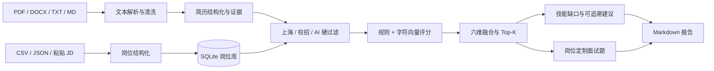

# 系统架构

## 数据流

## 边界与职责

| 模块 | 输入 | 输出 | 关键保证 |
|---|---|---|---|
| `parsers` | 文件字节、JD 字典 | `ResumeProfile`、`JobProfile` | 明确失败、原文证据、不猜测 |
| `matching` | 简历与岗位 | `MatchResult` | 先硬过滤、再稳定评分、分项可解释 |
| `retrieval` | 文本数组 | 归一化向量与 Top-K | 默认离线、可持久化、无需网络 |
| `repositories` | Pydantic 模型 | SQLite 记录 | 参数化 SQL、岗位去重、不存完整简历 |
| `agents` | 简历、岗位、评分 | 建议、问题、报告 | 缺失经历只标学习项，直接修改必须有证据 |
| `evaluation` | 排序与人工标签 | F1/Recall/MRR/nDCG | 空集合定义明确，可单元测试 |

## 为什么不是“大模型直接打分”

岗位地点、毕业窗口、学历和硬技能属于可验证约束，应由稳定规则处理；语义相似只描述文本接近程度，不能替代资格判断。当前版本因此使用确定性融合，LLM 只作为未来可插拔的项目相关性辅助，不拥有最终总分决策权。

## 持久化与隐私

`jobs` 表保存岗位完整结构化 JSON；`analyses` 表只保存评分和建议摘要。简历原文保留在进程内的 Streamlit session，不写入数据库。删除操作按 `candidate_id` 清除本地分析摘要。

## 生产化替换点

- `parse_resume` / `parse_job`：可替换为 JSON Schema 约束的 LLM 提取器。
- `HashingEmbedder`：可替换为 BGE-M3；`VectorStore` 的 ID 接口不变。
- `project_overlap`：可接入 Cross-Encoder 或受约束 LLM 判断。
- SQLite：岗位规模增长后可迁移 PostgreSQL；向量层可迁移 FAISS/Milvus。
